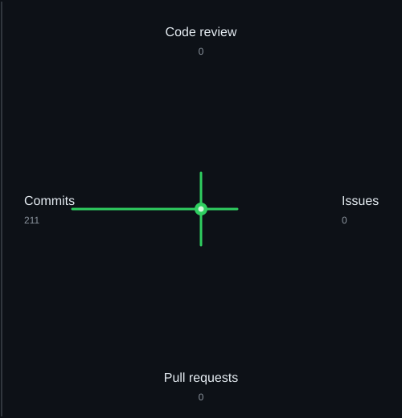

<picture>
  <source media="(prefers-color-scheme: dark)" srcset="./assets/name.dark.svg">
  <source media="(prefers-color-scheme: light)" srcset="./assets/name.light.svg">
  
</picture>

  Computer&nbsp;Science&nbsp;&amp;&nbsp;Engineering&nbsp;| Competitive&nbsp;Programming 
  <picture>
    <source media="(prefers-color-scheme: dark)" srcset="./assets/accent.dark.svg">
    <source media="(prefers-color-scheme: light)" srcset="./assets/accent.light.svg">
    
  </picture>

  I am a Computer Science and Engineering student interested in programming, problem solving, and software engineering.

  I enjoy competitive programming and working with different programming languages and technologies. Currently, I am learning C# and ASP.NET Core for backend engineering while continuing to improve my problem solving skills.

  Final year Computer Science and Engineering student at Khwaja Yunus Ali University, Sirajganj.

 

  <a href="https://github.com/iamsiamhossen">
    <picture>
      <source media="(prefers-color-scheme: dark)" srcset="./assets/pill-github.dark.svg">
      <source media="(prefers-color-scheme: light)" srcset="./assets/pill-github.light.svg">
      
    </picture>
  </a>&nbsp;
  <a href="https://www.linkedin.com/in/iamsiamhossen/">
    <picture>
      <source media="(prefers-color-scheme: dark)" srcset="./assets/pill-linkedin.dark.svg">
      <source media="(prefers-color-scheme: light)" srcset="./assets/pill-linkedin.light.svg">
      
    </picture>
  </a>&nbsp;
  <a href="https://codeforces.com/profile/iamsiamhossen">
    <picture>
      <source media="(prefers-color-scheme: dark)" srcset="./assets/pill-codeforces.dark.svg">
      <source media="(prefers-color-scheme: light)" srcset="./assets/pill-codeforces.light.svg">
      
    </picture>
  </a>&nbsp;
  <a href="https://leetcode.com/u/iamsiamhossen/">
    <picture>
      <source media="(prefers-color-scheme: dark)" srcset="./assets/pill-leetcode.dark.svg">
      <source media="(prefers-color-scheme: light)" srcset="./assets/pill-leetcode.light.svg">
      
    </picture>
  </a>

  
  &nbsp;&nbsp;
  
  &nbsp;&nbsp;
  
  &nbsp;&nbsp;
  
  &nbsp;&nbsp;
  
  &nbsp;&nbsp;
  
  &nbsp;&nbsp;
  
  &nbsp;&nbsp;
  
  &nbsp;&nbsp;
  
  &nbsp;&nbsp;
  
  &nbsp;&nbsp;
  
  &nbsp;&nbsp;
  
  &nbsp;&nbsp;
  
  &nbsp;&nbsp;
  
  &nbsp;&nbsp;
  <picture>
    <source media="(prefers-color-scheme: dark)" srcset="./assets/github-icon.dark.svg">
    <source media="(prefers-color-scheme: light)" srcset="./assets/github-icon.light.svg">
    
  </picture>

