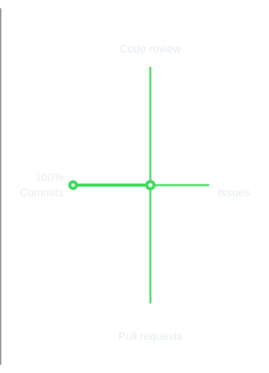

<h1 align="left">Siam Hossen</h1>

  <strong>Computer Science & Engineering | Competitive Programming</strong>

  I am a Computer Science and Engineering student interested in programming, problem solving, and software engineering.

  I enjoy competitive programming and working with different programming languages and technologies. Currently, I am learning C# and ASP.NET Core for backend engineering while continuing to improve my problem-solving skills.

  Final-year Computer Science and Engineering student at Khwaja Yunus Ali University, Sirajganj.

  <a href="mailto:iamsiamhossen@gmail.com">Email</a>
  &nbsp;·&nbsp;
  <a href="https://github.com/iamsiamhossen">GitHub</a>

 

<table width="100%">
  <tr>
    <td width="55%" valign="middle">
      <h3>Technical Interests</h3>
      
Competitive Programming

      
Backend Engineering

      
Software Engineering

       
      

        <a href="https://github.com/iamsiamhossen">
          View my repositories →
        </a>
      

    </td>
    <td width="45%" valign="middle">
      <h3 align="center">GitHub Activity</h3>
      
    </td>
  </tr>
</table>

  
  &nbsp;&nbsp;
  
  &nbsp;&nbsp;
  
  &nbsp;&nbsp;
  
  &nbsp;&nbsp;
  
  &nbsp;&nbsp;
  
  &nbsp;&nbsp;
  
  &nbsp;&nbsp;
  
  &nbsp;&nbsp;
  
  &nbsp;&nbsp;
  
  &nbsp;&nbsp;
  
  &nbsp;&nbsp;
  
  &nbsp;&nbsp;
  
  &nbsp;&nbsp;
  
  &nbsp;&nbsp;
  

